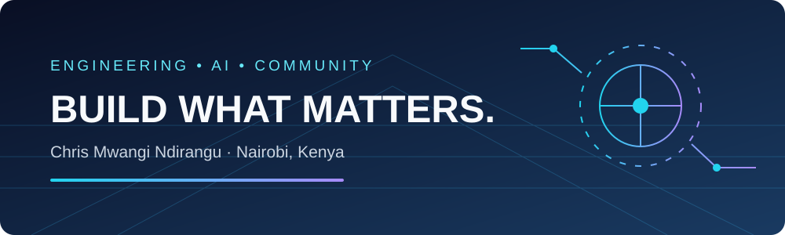
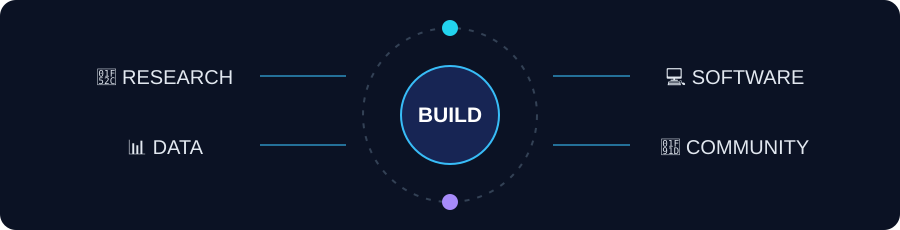

<div align="center">



# 👋 Hi, I'm Chris Mwangi Ndirangu

### AI Engineer • Software Engineer • Data Scientist • Technology Builder

**Tech Lead at American Corner Mtaani**  
**Founder of Techruptors**

Building intelligent digital products across **AI, software engineering, data science, mobile development, cloud systems, enterprise technology, and emerging technologies.**

<br/>

[](https://github.com/chrisndirangu54)
[](https://linkedin.com/in/chris-mwangi-abb36615b/)
[](https://www.tekntandao.com)
[](https://sokonis.shop)
[](https://techruptors-africa.web.app/)

</div>

---

<div align="center">



*Original open-source vector illustrations and lightweight SVG animations, created for this profile.*

</div>

---

## 🎨 Visual Engineering Playground

<div align="center">


*Original MIT-licensed vector illustration: two cartoon developer bots, coding terminals, animated indicator lights, and circuit connections.*

</div>

Explore the [open-source illustration assets](assets/) and [play Circuit Quest](https://htmlpreview.github.io/?https://github.com/chrisndirangu54/chrisndirangu54/blob/main/games/circuit-quest/index.html). This profile pairs professional engineering and technology community work with playful, accessible experiments.

---

## 👨‍💻 About Me

I am a multidisciplinary technology professional working across **artificial intelligence, software engineering, data science, mobile development, cloud computing, enterprise systems, automation, and digital innovation**.

As **Tech Lead at American Corner Mtaani**, I contribute to technology initiatives, community learning, innovation activities, and practical exposure to emerging technologies.

I am also the **Founder of Techruptors**, a technology community focused on creating spaces where developers, innovators, students, founders, and technology enthusiasts can learn, experiment, collaborate, and build.

Beyond community and technology leadership, I develop digital products and explore how intelligent software can improve businesses, services, decision-making, and everyday experiences.

```text
Research → Design → Build → Test → Deploy → Learn → Improve
```

---

# ⚡ Current Focus

```text
🤖 Artificial Intelligence
📊 Data Science
💻 Software Engineering
📱 Mobile Applications
🌐 Web Applications
☁️ Cloud Platforms
🏢 Enterprise Systems
🔌 Systems Integration
🧠 Generative AI
⛓️ Blockchain
📡 Smart Technology
🚀 Technology Entrepreneurship
```

---

# 🧰 Tech Stack

## Languages

<p align="center">


</p>

---

## Artificial Intelligence & Data Science

<p align="center">


</p>

---

## Mobile Development

<p align="center">


</p>

---

## Web & Backend

<p align="center">


</p>

---

## Databases

<p align="center">


</p>

---

## Cloud & DevOps

<p align="center">


</p>

---

## Blockchain & Emerging Technology

<p align="center">


</p>

---

## Development Tools

<p align="center">


</p>

---

# 🚀 Selected Work

## 🛒 Sokonis

### AI-Powered Grocery & Digital Commerce

**Sokonis** is a technology platform exploring how artificial intelligence can improve grocery shopping and digital commerce.

Its public-facing vision centers on creating more convenient, personalized, and intelligent shopping experiences.

<p>

[](https://sokonis.shop)

</p>

**Focus Areas**

`AI` • `Commerce` • `Mobile` • `Personalization` • `Digital Retail`

---

## 🧩 TeknTandao Workspace

### Connected Business Software

**TeknTandao Workspace** is a business-technology initiative focused on making digital tools easier for organizations to access and use from a more unified working environment.

The platform explores a modular approach to business applications, allowing organizations to use digital tools according to their operational requirements without unnecessary complexity.

**Focus Areas**

`Enterprise Software` • `Business Applications` • `Automation` • `Productivity` • `Digital Transformation`

> Building simpler ways for businesses to adopt and connect technology.

<details><summary>🔗 Alternative TeknTandao Firebase deployment</summary>

[Open TeknTandao on Firebase Hosting](https://tekntandao.web.app/). This is an alternative public deployment; the primary website remains [tekntandao.com](https://www.tekntandao.com/).

</details>

---

## 💻 TeknTandao

### Technology for Businesses and Connected Environments

**TeknTandao** develops and integrates practical technology solutions for businesses, organizations, and modern connected environments.

Its work spans digital systems as well as ICT infrastructure.

### Areas of Focus

- 💻 Software Development
- 🌐 Web Applications
- 📱 Mobile Applications
- 🤖 Artificial Intelligence
- 📊 Data & Analytics
- ☁️ Cloud Technology
- 🔌 Systems Integration
- 🏢 Business Technology
- 📡 Networking
- 📶 Wi-Fi Solutions
- 🛰️ Satellite Internet Solutions
- 📹 CCTV
- 🏠 Smart Technology
- 🛒 Point-of-Sale Systems
- ⚙️ Digital Automation

<p>

[](https://www.tekntandao.com)

</p>

---

# 🌐 Community & Technology Leadership

## 🇺🇸 Tech Lead — American Corner Mtaani

I serve as **Tech Lead at American Corner Mtaani**, contributing to technology-driven programming, innovation activities, technical learning, and community engagement.

My interests in this role include:

- Technology education
- Software development
- Artificial intelligence
- Digital skills
- Innovation
- Emerging technologies
- Developer communities
- Practical technology experimentation

---

## ⚡ Founder — Techruptors

🌐 **[Explore the TechRuptors community website](https://techruptors-africa.web.app/)**

**Techruptors** is a technology community built around curiosity, experimentation, innovation, collaboration, and practical learning.

The community creates opportunities for people interested in technology to:

```text
LEARN
  ↓
EXPERIMENT
  ↓
BUILD
  ↓
COLLABORATE
  ↓
SHARE
  ↓
INNOVATE
```

Areas of interest include:

`AI` • `Software Development` • `Data Science` • `Robotics` • `VR` • `3D Technology` • `Entrepreneurship` • `Emerging Tech`

---

# 🎮 Open-Source Playground

<div align="center">

**Circuit Quest** is a tiny, zero-dependency browser arcade game: catch green data nodes, dodge red glitches, and earn points. Supports keyboard and touch input.

[](https://htmlpreview.github.io/?https://github.com/chrisndirangu54/chrisndirangu54/blob/main/games/circuit-quest/index.html)
[](games/circuit-quest/index.html)


</div>

> The game preview uses the third-party HTMLPreview service to render the standalone HTML file. All game code and art are in this repository; no third-party JavaScript or game assets are required. GitHub README pages cannot execute embedded JavaScript games.

---

# 🧪 Public GitHub Exploration

My GitHub also reflects years of experimentation across several technology domains, including:

```text
Artificial Intelligence
Machine Learning
GANs
Mobile Applications
Web Development
Blockchain
KYC & Identity
Search Engines
Chatbots
Digital Media
FinTech
Trading Systems
Cloud Technology
Developer Tools
Enterprise Applications
```

Some repositories represent **experiments, learning exercises, forks, clones, reference implementations, and technology exploration**, while others reflect original product development.

This distinction matters to me: open-source exploration is a way to understand systems, while original projects are where those lessons are transformed into new products and solutions.

---

# 🧠 Areas of Interest

<table>
<tr>
<td width="50%" valign="top">

### Artificial Intelligence

- Generative AI
- Large Language Models
- Machine Learning
- Deep Learning
- AI Agents
- Computer Vision
- NLP
- Recommendation Systems
- RAG
- Automation

</td>
<td width="50%" valign="top">

### Software Engineering

- Mobile Applications
- Web Platforms
- Cloud Systems
- APIs
- Enterprise Software
- Systems Integration
- Distributed Systems
- Developer Tools
- Digital Platforms
- Product Engineering

</td>
</tr>
</table>

---

# 🧭 What I Like Building

<div align="center">

### AI × Software × Data × Business × People

</div>

```text
                ┌─────────────────┐
                │       AI        │
                └────────┬────────┘
                         │
        ┌────────────────┼────────────────┐
        │                │                │
        ▼                ▼                ▼
   SOFTWARE            DATA           AUTOMATION
        │                │                │
        └────────────────┼────────────────┘
                         │
                         ▼
                 REAL-WORLD SYSTEMS
```

I am especially interested in projects where different technical fields converge to produce useful real-world systems.

---

# 📊 GitHub Statistics

<div align="center">


</div>

<br/>

<div align="center">


</div>

---

# 🏆 GitHub Profile

<div align="center">


</div>

---

# 🐍 Contribution Activity

<div align="center">


</div>

> The contribution snake requires a GitHub Actions workflow in the profile repository to generate the SVG.

---

# 🔬 Technology Philosophy

<div align="center">

### Technology should not merely digitize an existing process.

### It should make the process **smarter, simpler, faster, or more accessible.**

</div>

I approach engineering as an iterative process:

```text
Understand the problem
        ↓
Research
        ↓
Design
        ↓
Prototype
        ↓
Engineer
        ↓
Test
        ↓
Deploy
        ↓
Measure
        ↓
Improve
```

---

# 🤝 Let's Build

I am interested in collaboration involving:

- 🤖 Artificial Intelligence
- 💻 Software Engineering
- 📊 Data Science
- 📱 Mobile Development
- 🏢 Enterprise Technology
- ☁️ Cloud Systems
- 🔌 Systems Integration
- 🚀 Startups
- 🧑‍💻 Developer Communities
- 🌍 Technology for Africa
- 🎓 Technology Education
- 🔬 Applied Research

---

<div align="center">

# ⚡ BUILD • LEARN • EXPERIMENT • INNOVATE

### Creating useful technology at the intersection of software, intelligence, data, and people.

<br/>

[](https://github.com/chrisndirangu54)
[](https://linkedin.com/in/chris-mwangi-abb36615b/)
[](https://www.tekntandao.com)
[](https://sokonis.shop)

<br/>

**Nairobi, Kenya 🇰🇪**

</div>
